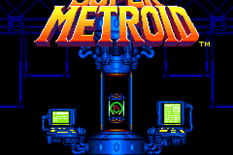
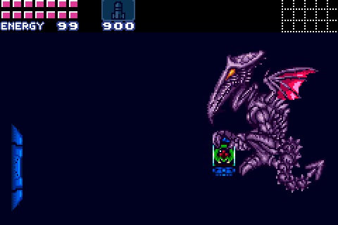
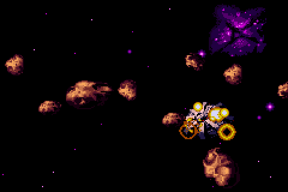
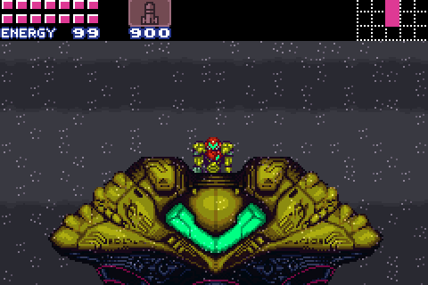
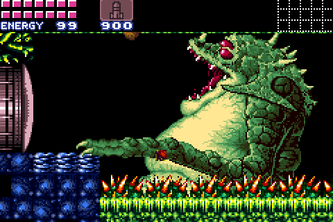
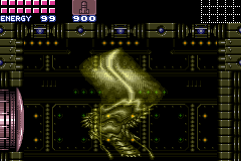
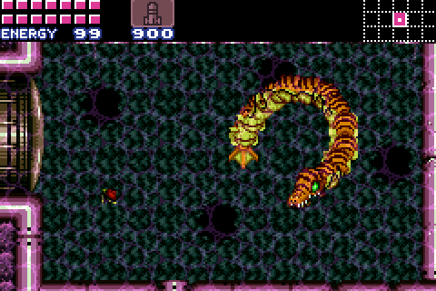
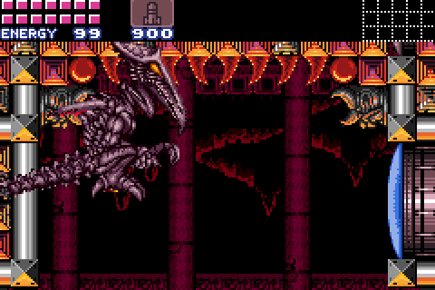
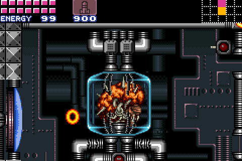
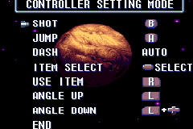

# Super Metroid for the Game Boy Advance

<p align="center">
  
  
  
  <br>
  
  
  
  <br>
  
  
  
</p>

Super Metroid, running natively on the Game Boy Advance. The game itself is
the [snesrev/sm](https://github.com/snesrev/sm) decompilation, the SNES game's
code rewritten as C. This port compiles that C for the GBA's ARM7TDMI and
replaces the SNES's graphics, sound and input with the GBA's own. Nothing is
emulated: the GBA's 16.8 MHz CPU has no time to spare for an emulator.
Almost every room runs at or near 60 frames per second.

The port includes none of the game's data. You build the cartridge from your
own copy of the SNES ROM.

## Building the cartridge

You need clang and lld (it's built with LLVM 22), CMake, Python 3 and git.
There's no devkitARM or GCC. On Debian or Ubuntu:

```
sudo apt install clang lld llvm cmake python3 git
```

Then:

1. Clone this repository and check out the `gba-port` branch:

   ```
   git clone -b gba-port https://github.com/<you>/sm.git
   cd sm
   ```

2. Put your Super Metroid ROM in that directory and name it `sm.smc`. It must
   be the US release without a copier header (sha1
   `da957f0d63d14cb441d215462904c4fa8519c613`).

3. Build:

   ```
   ./build-gba.sh
   ```

   The first build also fetches LLVM's compiler-rt sources, a few MB, for the
   division routines the ARM7TDMI lacks. It then compiles the game and
   prepares the ROM's data for the GBA: the graphics are converted as the game
   loads them, and the sound samples are decoded ahead of time.

4. The cartridge is `sm.gba`, in the same directory. Run it in
   [mGBA](https://mgba.io) or on a flash cartridge. Saves go to the
   cartridge's SRAM (in an emulator, a `.sav` file next to `sm.gba`).

Instead of building it all, you can download `sm-engine.gba` and
`make_cartridge.py` from a release and add your ROM's data to the engine:

```
python3 make_cartridge.py sm-engine.gba sm.smc sm.gba
```

## Reading more

- [Progress report](docs/HOW-IT-WAS-MADE.md): from a black screen to every
  room of the game, the notable changes and the bugs found on the way.
- [Issues to report upstream](docs/UPSTREAM-ISSUES.md): bugs found in the
  decompilation while porting it, with their fixes.
- [Porting a SNES game to the GBA](docs/PORTING-GUIDE.md): a guide for agents
  (and people) attempting a similar port. It covers the approach, the
  hardware mapping, the tools for checking the result, and the pitfalls.

## Controls

The SNES pad has X and Y buttons and the GBA doesn't, so gameplay uses the
layout of the GBA Metroids, *Zero Mission* and *Fusion*:

| Action                 | SNES (default)        | GBA                                  |
|------------------------|-----------------------|--------------------------------------|
| Jump                   | A                     | A                                    |
| Shoot                  | X                     | B                                    |
| Run                    | hold B                | always on                            |
| Aim diagonally up      | R                     | hold L                               |
| Aim diagonally down    | L                     | hold L + Down                        |
| Pick an item           | Select cycles through them | hold R, Select picks what R readies instead of missiles |
| Missiles (or the item) | pick, then X          | hold R, then B                       |
| X-ray scope            | pick, then hold B     | pick, then hold R                    |
| Power bombs            | pick, then X in morph ball | hold R in morph ball, then B    |
| Put the item away      | Y                     | let go of R                          |
| Pause, map             | Start                 | Start                                |

So, as on the GBA Metroids, missiles are a shoulder button away: hold R and
press B. With R held, Select cycles R's item through missiles, super missiles, the
grapple beam and the X-ray scope, whichever Samus has found, shown on the HUD;
the pick is kept for the next time R is held. Select does nothing without R. Letting go of R doesn't drop Samus from the grapple beam. Because Samus always runs, the speed booster
charges whenever she runs long enough.

On the title screen, the menus and the pause screen, each button is the SNES
button of the same name (B goes back).

The options menu's Controller Setting Mode shows these controls, with the
GBA's buttons. They can't be changed there: only END and RESET do anything.

<p align="center">
  
</p>

## How it differs from the SNES

- **The screen.** The GBA's screen is 240x160, and the SNES's is 256x224.
  During gameplay the GBA shows a 1:1 crop that follows Samus vertically, with
  the HUD at the top. The title screen, menus and pause screen show the whole
  SNES screen, squashed to fit.
- **Sound.** The SNES's sound driver runs on the GBA's CPU, with the SNES's
  echo, and a mixer in place of the SNES's sound chip. It sounds right but
  has the GBA's 8-bit hiss.
- **Effects.** The SNES's color math and windows are mapped onto the GBA's
  blending and windows: rain, fog, water, heat shimmer, shadows, the X-ray
  scope's cone and power bombs. The GBA can't subtract colors, so darkened
  rooms are approximated, and power bombs' explosions brighten the screen
  rather than turning it yellow.
- **Speed.** Timed in every room, none runs below 59 fps. Ridley's fight
  on Ceres station averages 58 fps but dips to about 50, doors take longer
  than on the SNES, and the X-ray scope and big power bomb explosions slow
  the game down.

## The PC version

This branch keeps the decompilation's PC build too, which runs the C code and
the original game side by side and compares them frame by frame. See
[BUILDING.md](BUILDING.md) for its build, and the
[snesrev Discord](https://discord.gg/AJJbJAzNNJ) for the project.
