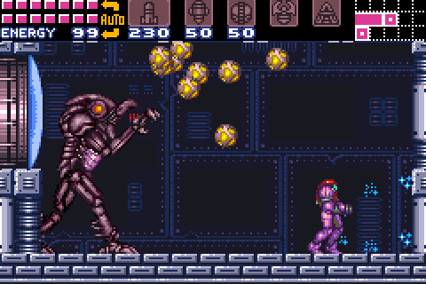
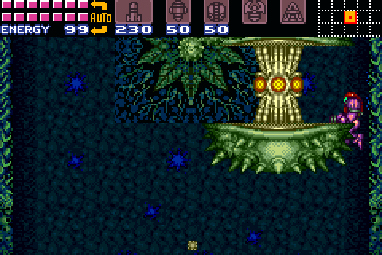
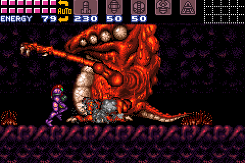
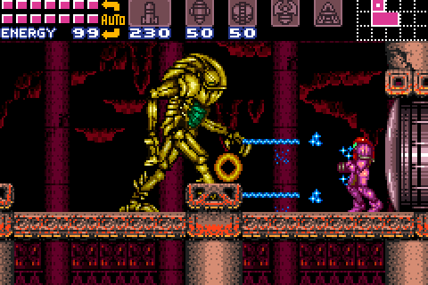
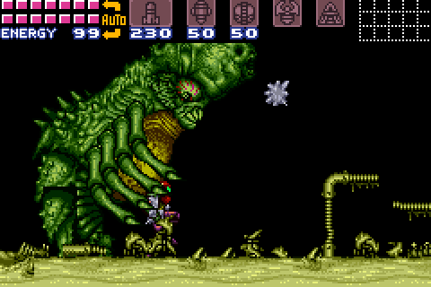
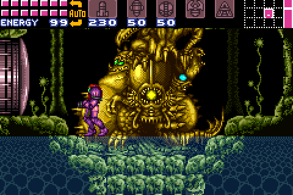
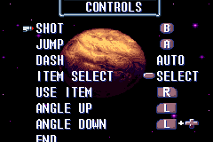

# Super Metroid for the Game Boy Advance

<p align="center">
  
  
  
  <br>
  
  
  
  <br>
  
  
  
  <br>
  
  
  
  <br>
  
  
  
</p>

Super Metroid, running natively on the Game Boy Advance. The game itself is
the [snesrev/sm](https://github.com/snesrev/sm) decompilation, the SNES game's
code rewritten as C. This port compiles that C for the GBA's ARM7TDMI and
replaces the SNES's graphics, sound and input with the GBA's own. Nothing is
emulated: the GBA's 16.8 MHz CPU has no time to spare for an emulator.
Every room runs at 60 frames per second.

The port includes none of the game's data. You build the cartridge from your
own copy of the SNES ROM.

## Making the cartridge

You need your own copy of the Super Metroid ROM: the Japan/USA release,
"Super Metroid (Japan, USA) (En,Ja)", sha1
`da957f0d63d14cb441d215462904c4fa8519c613`. Any file name works, and so does
a zip with the ROM in it or a ROM with a copier header. The cartridge
contains the ROM's data, so it can't be shared.

### From a release

No compiler needed, only Python 3.

1. From the [latest release](https://github.com/nickdesaulniers/sm/releases/latest), download
   `sm-engine.gba`, `make_cartridge.py` and `squash_font.py` into one folder.
2. Put your ROM in that folder.
3. Run:

   ```
   python3 make_cartridge.py sm-engine.gba . sm.gba
   ```

   It finds the ROM by its checksum, says what's wrong if it isn't the right
   one, and writes the cartridge, `sm.gba`, in a second or so.

Use all three files from the same release.

### From source

You need LLVM 22 (clang, lld and llvm-objcopy), CMake, Python 3 and git.
There's no devkitARM or GCC. Older clangs may not fit the code in the GBA's
fast RAM: Ubuntu 24.04's own clang 18 doesn't. On Debian or Ubuntu, get LLVM
22 from [apt.llvm.org](https://apt.llvm.org):

```
wget https://apt.llvm.org/llvm.sh && sudo bash llvm.sh 22
sudo apt install cmake python3 git
export PATH=/usr/lib/llvm-22/bin:$PATH
```

Fedora 44's own packages are LLVM 22 (`sudo dnf install clang lld llvm cmake
python3 git`); other systems and Windows are in
[docs/BUILDING-GBA.md](docs/BUILDING-GBA.md).

1. Clone the `gba-port` branch:

   ```
   git clone -b gba-port https://github.com/nickdesaulniers/sm.git sm
   cd sm
   ```

2. Copy your ROM into that directory, or pass its path (or a directory it's
   in) to the script.
3. Build:

   ```
   ./build-gba.sh
   ```

   The first build fetches LLVM's compiler-rt sources (about 30 MB) for the
   division routines the ARM7TDMI lacks. The cartridge is `sm.gba`, in that
   directory.

### Playing it

Run `sm.gba` in [mGBA](https://mgba.io) or another GBA emulator, or copy it
to a flash cartridge. Saves go to the cartridge's SRAM (in an emulator, a
`.sav` file next to `sm.gba`). [docs/BUILDING-GBA.md](docs/BUILDING-GBA.md)
has the details: checking the ROM, flash cartridges and save types, building
by hand, and what each error means.

## Controls

The SNES pad has X and Y buttons and the GBA doesn't, so gameplay uses the
layout of the GBA Metroids, *Zero Mission* and *Fusion*:

| Action                 | SNES (default)        | GBA                                  |
|------------------------|-----------------------|--------------------------------------|
| Jump                   | A                     | A                                    |
| Shoot                  | X                     | B                                    |
| Run                    | hold B                | always on                            |
| Aim diagonally up      | R                     | hold L                               |
| Aim diagonally down    | L                     | hold L + Down                        |
| Pick an item           | Select cycles through them | hold R, Select picks what R readies instead of missiles |
| Missiles (or the item) | pick, then X          | hold R, then B                       |
| X-ray scope            | pick, then hold B     | pick, then hold R                    |
| Power bombs            | pick, then X in morph ball | hold R in morph ball, then B    |
| Put the item away      | Y                     | let go of R                          |
| Pause, map             | Start                 | Start                                |

So, as on the GBA Metroids, missiles are a shoulder button away: hold R and
press B. With R held, Select cycles R's item through missiles, super
missiles, power bombs, the grapple beam and the X-ray scope, whichever Samus
has found, shown on the HUD; the pick is kept for the next time R is held.
Select does nothing without R, or in morph ball, where R readies power bombs
whatever was picked. Letting go of R doesn't drop Samus from the grapple beam.
The charge beam's special attacks work as on the SNES: with power bombs
readied (R held, power bombs picked), hold B until the beam is fully charged
(about two seconds) and Samus fires the wave, ice, spazer or plasma attack,
for a power bomb each. They need the charge beam and exactly one of those four
beams; with several beams together there is no special attack.
Because Samus always runs, the speed booster charges whenever she runs long
enough.

On the title screen, the menus and the pause screen, each button is the SNES
button of the same name (B goes back).

The options menu's CONTROLS screen shows these controls, with the GBA's
buttons. They can't be changed there: END goes back.

<p align="center">
  
</p>

## How it differs from the SNES

- **The screen.** The GBA's screen is 240x160, and the SNES's is 256x224.
  During gameplay the GBA shows a 1:1 crop that follows Samus vertically, with
  the HUD at the top. The title screen, menus and pause screen show the whole
  SNES screen, squashed to fit.
- **Sound.** The SNES's sound driver runs on the GBA's CPU, with the SNES's
  echo, and a mixer in place of the SNES's sound chip. It sounds right but
  has the GBA's 8-bit hiss.
- **Effects.** The SNES's color math and windows are mapped onto the GBA's
  blending and windows: rain, fog, water, heat shimmer, shadows, the X-ray
  scope's cone and power bombs. The GBA can't subtract colors, so darkened
  rooms are approximated.
- **Speed.** Timed in every room, all run at 60 fps. Every boss's fight
  averages 59.7 fps, though Kraid's slowest second is 53. Doors take about
  as long as on the SNES (a median of 107 frames, against 105). Pausing, a
  game over and the escapes drop to about 40 fps for a second as their
  scenes load.

## Reporting issues

Found a bug, a glitch, a slowdown or a sound problem? Please open an issue
on [the issue tracker](https://github.com/nickdesaulniers/sm/issues). It helps to include:

- The release, or the commit you built (`git rev-parse --short HEAD`).
- Where you play it: the emulator and its version, or the flash cartridge.
- Where it happened (area, room, boss) and what you were doing.
- If you can, an mGBA save state from just before it, or your `.sav` file,
  and a screenshot or a short video.

Please don't attach ROMs or cartridges (`sm.gba`): they contain Nintendo's
data. `sm-engine.gba` is fine.

Some bugs are the original game's, kept faithfully by the decompilation;
those found while porting are listed in
[docs/UPSTREAM-ISSUES.md](docs/UPSTREAM-ISSUES.md).

## Reading more

- [Building the cartridge](docs/BUILDING-GBA.md): every system, the ROM,
  flash cartridges, saves, and what to do when something goes wrong.
- [Developer tools](docs/DEVELOPER-TOOLS.md): start Samus at any station or
  boss, with any loadout, to test a room or a fight without playing up to it.
- [Progress report](docs/HOW-IT-WAS-MADE.md): from a black screen to the
  whole game, the notable changes and the bugs found on the way, with
  before-and-after pictures.
- [Issues to report upstream](docs/UPSTREAM-ISSUES.md): bugs found in the
  decompilation while porting it, with their fixes.
- [Porting a SNES game to the GBA](docs/PORTING-GUIDE.md): a guide for agents
  (and people) attempting a similar port. It covers the approach, the
  hardware mapping, the tools for checking the result, and the pitfalls.

## The PC version

This branch keeps the decompilation's PC build too, which runs the C code and
the original game side by side and compares them frame by frame. See
[BUILDING.md](BUILDING.md) for its build, and the
[snesrev Discord](https://discord.gg/AJJbJAzNNJ) for the project.

## Credits

- **The game:** Super Metroid is Nintendo's (1994). This port and its
  repository include none of the game's code or data: the cartridge is built
  from your own ROM.
- **The decompilation:** the [snesrev/sm](https://github.com/snesrev/sm)
  authors, who rewrote the game as C and check it against the original
  frame by frame. Its SNES emulation, which those checks and this port's
  tests run on, is from elzo_d. The decompilation and this port are under
  its [MIT license](LICENSE.txt).
- **The toolchain:** [LLVM](https://llvm.org): clang and lld build the
  cartridge, and compiler-rt's builtins are part of it.
- **The tests:** [mGBA](https://mgba.io), whose library runs the cartridge
  headless for the room tour and the scenarios (`tools/mgba/`).
- **The port:** Nick Desaulniers, with Claude Opus 5.5 as co-author of every
  commit. [How it was made](docs/HOW-IT-WAS-MADE.md) tells the story.
