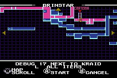
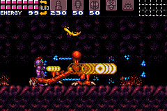
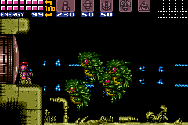

# Super Metroid for the Game Boy Advance

<p align="center">
  
  
  
  <br>
  
  
  
  <br>
  
  
  
  <br>
  
  
  
  <br>
  
  
  
</p>

Super Metroid, running natively on the Game Boy Advance. The game itself is
the [snesrev/sm](https://github.com/snesrev/sm) decompilation, the SNES game's
code rewritten as C. This port compiles that C for the GBA's ARM7TDMI and
replaces the SNES's graphics, sound and input with the GBA's own. Nothing is
emulated: the GBA's 16.8 MHz CPU has no time to spare for an emulator.
Every room runs at 60 frames per second.

The port includes none of the game's data. You build the cartridge from your
own copy of the SNES ROM.

## Building the cartridge

You need your own copy of the Super Metroid ROM: the Japan/USA release,
"Super Metroid (Japan, USA) (En,Ja)", sha1
`da957f0d63d14cb441d215462904c4fa8519c613`, by any name. (A 512-byte copier
header at its start is fine: it is dropped; so is a zip with the ROM in it.) The cartridge contains the ROM, so
it can't be shared.

You also need clang and lld (it's built with LLVM 22), CMake, Python 3 and
git. There's no devkitARM or GCC. On Debian or Ubuntu:

```
sudo apt install clang lld llvm cmake python3 git
```

(Other systems, and Windows: [docs/BUILDING-GBA.md](docs/BUILDING-GBA.md).)

1. Clone this repository's `gba-port` branch:

   ```
   git clone -b gba-port <this repository's URL> sm
   cd sm
   ```

2. Copy your ROM into that directory (any name: it's found by its checksum),
   or give its path, or a directory it's in, to `./build-gba.sh`.

3. Build:

   ```
   ./build-gba.sh
   ```

   The first build fetches LLVM's compiler-rt sources (about 30 MB) for the
   division routines the ARM7TDMI lacks, then compiles the game and prepares
   the ROM's data for the GBA: the graphics are converted as the game loads
   them, and the sound samples are decoded ahead of time. It takes about a
   minute. The script checks the ROM first, and says what is wrong if it
   isn't the right one.

4. The cartridge is `sm.gba`, in that directory. Run it in
   [mGBA](https://mgba.io) or on a flash cartridge. Saves go to the
   cartridge's SRAM (in an emulator, a `.sav` file next to `sm.gba`).

Instead of building it all, you can download `sm-engine.gba`,
`make_cartridge.py` and `squash_font.py` from a release into one folder and
add your ROM's data to the engine, with Python 3 alone:

```
python3 make_cartridge.py sm-engine.gba sm.smc sm.gba
```

Prerequisites for other systems, flash cartridges, saves, checking the ROM
and what to do when something goes wrong are in
[docs/BUILDING-GBA.md](docs/BUILDING-GBA.md).

## Reading more

- [Progress report](docs/HOW-IT-WAS-MADE.md): from a black screen to every
  room of the game, the notable changes and the bugs found on the way.
- [Issues to report upstream](docs/UPSTREAM-ISSUES.md): bugs found in the
  decompilation while porting it, with their fixes.
- [Porting a SNES game to the GBA](docs/PORTING-GUIDE.md): a guide for agents
  (and people) attempting a similar port. It covers the approach, the
  hardware mapping, the tools for checking the result, and the pitfalls.

## Controls

The SNES pad has X and Y buttons and the GBA doesn't, so gameplay uses the
layout of the GBA Metroids, *Zero Mission* and *Fusion*:

| Action                 | SNES (default)        | GBA                                  |
|------------------------|-----------------------|--------------------------------------|
| Jump                   | A                     | A                                    |
| Shoot                  | X                     | B                                    |
| Run                    | hold B                | always on                            |
| Aim diagonally up      | R                     | hold L                               |
| Aim diagonally down    | L                     | hold L + Down                        |
| Pick an item           | Select cycles through them | hold R, Select picks what R readies instead of missiles |
| Missiles (or the item) | pick, then X          | hold R, then B                       |
| X-ray scope            | pick, then hold B     | pick, then hold R                    |
| Power bombs            | pick, then X in morph ball | hold R in morph ball, then B    |
| Put the item away      | Y                     | let go of R                          |
| Pause, map             | Start                 | Start                                |

So, as on the GBA Metroids, missiles are a shoulder button away: hold R and
press B. With R held, Select cycles R's item through missiles, super
missiles, power bombs, the grapple beam and the X-ray scope, whichever Samus
has found, shown on the HUD; the pick is kept for the next time R is held.
Select does nothing without R, or in morph ball, where R readies power bombs
whatever was picked. Letting go of R doesn't drop Samus from the grapple beam.
The charge beam's special attacks work as on the SNES: with power bombs
readied (R held, power bombs picked), hold B until the beam is fully charged
(about two seconds) and Samus fires the wave, ice, spazer or plasma attack,
for a power bomb each. They need the charge beam and exactly one of those four
beams; with several beams together there is no special attack.
Because Samus always runs, the speed booster charges whenever she runs long
enough.

On the title screen, the menus and the pause screen, each button is the SNES
button of the same name (B goes back).

The options menu's Controller Setting Mode shows these controls, with the
GBA's buttons. They can't be changed there: only END and RESET do anything.

<p align="center">
  
</p>

## How it differs from the SNES

- **The screen.** The GBA's screen is 240x160, and the SNES's is 256x224.
  During gameplay the GBA shows a 1:1 crop that follows Samus vertically, with
  the HUD at the top. The title screen, menus and pause screen show the whole
  SNES screen, squashed to fit.
- **Sound.** The SNES's sound driver runs on the GBA's CPU, with the SNES's
  echo, and a mixer in place of the SNES's sound chip. It sounds right but
  has the GBA's 8-bit hiss.
- **Effects.** The SNES's color math and windows are mapped onto the GBA's
  blending and windows: rain, fog, water, heat shimmer, shadows, the X-ray
  scope's cone and power bombs. The GBA can't subtract colors, so darkened
  rooms are approximated.
- **Speed.** Timed in every room, all run at 60 fps. Every boss's fight
  averages 59.7 fps, though Kraid's slowest second is 53. Doors take about
  as long as on the SNES (a median of 107 frames, against 105). Pausing, a
  game over and the escapes drop to about 40 fps for a second as their
  scenes load.

## Developer tools

The cartridge can start Samus anywhere, with any loadout, to test a room, a
fight or a weapon without playing up to it. It's the developers' own debug
mode: the game keeps a switch (`enable_debug`) that makes the load-game map
list every load station, the developers' spawn points among them. The
cartridge's buttons turn it on, and add a loadout, the whole map and the
bosses' doors.

**Turning it on.** On the title screen or the file select, hold L and R and
press Start. A sound tells you, and it lasts until the console is reset
(Start + Select + L + R in the menus resets it, too). Nothing in the demos or
in play can turn it on.

**Spawning.** Pick a file and start it, as usual. A saved file goes to the map
of Planet Zebes as ever; with the tools on, a new file skips its intro and goes
there too (to play the intro instead, hold L from Start until the screen fades).

| Screen      | Buttons                                                                 |
|-------------|-------------------------------------------------------------------------|
| Planet Zebes | Up and Left, Down and Right or Select: another area. A or Start: that area |
| Area map    | Select: the next station; after an area's last, its bosses; then the first again. D-pad: scroll the map. A or Start: spawn. B: back to the areas |
|             | L: Samus as saved, or with ALL ITEMS                                    |

The map shows every room of the area, as if its map station had been used
(your file keeps what it had explored: the map is only dressed up while it's
up), and every station, visited or not: the area's save stations and
elevators, then the **debug stations**, numbered from 16, that no file ever
had. The one picked is the one the blinking marker is on. Under the map, a
line names it (or its room's number, in hex, for the unnamed), then a line
for Select (next) and L (the loadout, as saved or ALL ITEMS), and one for the
other buttons, each in a row of its own so they stay readable on the GBA's
squashed screen. For a boss's door the marker stays at the station that the
spawn loads, and the line names the boss.

<p align="center">
  
  
  
</p>

**The debug stations.** The game's own, in the order the map steps through
them (area, number: the room, by its pointer; it has each of the bosses' rooms
next to one, but only the Golden Torizo's inside it):

| Station | Room | Where |
|---------|------|-------|
| Crateria 16 | 91F8 | the landing site, at Samus's ship |
| Crateria 17 | 94FD | |
| Brinstar 16 | 9AD9 | |
| Brinstar 17 | A56B | next to Kraid: a door of Kraid's room leads here |
| Brinstar 18 | 9D19 | |
| Norfair 16 | A7DE | |
| Norfair 17 | A923 | next to Crocomire: a door leads into his room |
| Norfair 18 | B37A | next to Ridley |
| Norfair 19 | AA82 | next to Crocomire, by his room's other door |
| Norfair 20 | B236 | |
| Norfair 21 | B283 | the Golden Torizo's room, but the developers' spot is outside the room: the map spawns at 22's instead |
| Norfair 22 | B283 | the Golden Torizo's room, at its left door |
| Wrecked Ship 16 | CA08 | |
| Wrecked Ship 17 | CC6F | next to Phantoon |
| Maridia 16 | D1DD | |
| Maridia 17 | D78F | next to Draygon |
| Maridia 18 | D617 | next to Botwoon |
| Maridia 19 | D48E | |
| Tourian 16, 17 | DDF3 | next to Mother Brain |

**The bosses.** After an area's last station, the map goes on to its bosses'
doors (the game's own doors, from the side Samus comes in by): Bomb Torizo
(Crateria), Spore Spawn and Kraid (Brinstar), Crocomire and Ridley (Norfair),
Phantoon (Wrecked Ship), Botwoon and Draygon (Maridia) and Mother Brain
(Tourian). The spawn loads the area's last station, and when Samus has her
controls, goes through the door as if she had walked into it. (Crocomire's is
the hatch in the ceiling of his room, as in the game. As there, beams don't
hurt him: missiles in his mouth push him back.)

**Loadout.** L toggles between AS SAVED (what your file has) and ALL ITEMS:
1499 energy, 400 reserve, 230 missiles, 50 super missiles and 50 power bombs,
every item, and the charge, ice, wave and plasma beams (the spazer collected,
but plasma takes it off, as when the game gives you a beam or in its equipment
screen: with both on, no shots showed in testing). ALL ITEMS makes every boss
alive again, so that a file that has beaten them can fight them.

A spawn with a loadout can't save: it would write the loadout over your file,
so saving does nothing until you spawn again AS SAVED, or reset. Dying
goes back to the map, to spawn again.

**In the game.** Hold L, R and Select, and press: A to turn invincibility on
or off, B to refill energy and ammunition, Left to freeze the enemies or let
them go, Up to die (and so to go back to the map).

The SNES debug pad's own shortcuts (Select held with L or R, then A, B or
X: they would turn on an interrupt that menus have no handler for, or take
Samus's missiles away) are off.

These are the game's own debug features that the buttons reach (there's more
in the code: a Draygon that a second controller moves, a scroll position
saved and loaded, a demo recorder's pause). See the comments in
[gba/dev_tools.c](gba/dev_tools.c) and the
[porting guide](docs/PORTING-GUIDE.md).

## The PC version

This branch keeps the decompilation's PC build too, which runs the C code and
the original game side by side and compares them frame by frame. See
[BUILDING.md](BUILDING.md) for its build, and the
[snesrev Discord](https://discord.gg/AJJbJAzNNJ) for the project.

## Credits

- **The game:** Super Metroid is Nintendo's (1994). This port and its
  repository include none of the game's code or data: the cartridge is built
  from your own ROM.
- **The decompilation:** the [snesrev/sm](https://github.com/snesrev/sm)
  authors, who rewrote the game as C and check it against the original
  frame by frame. Its SNES emulation, which those checks and this port's
  tests run on, is from elzo_d. The decompilation and this port are under
  its [MIT license](LICENSE.txt).
- **The toolchain:** [LLVM](https://llvm.org): clang and lld build the
  cartridge, and compiler-rt's builtins are part of it.
- **The tests:** [mGBA](https://mgba.io), whose library runs the cartridge
  headless for the room tour and the scenarios (`tools/mgba/`).
- **The port:** Nick Desaulniers, with Claude Opus 5.5 as co-author of every
  commit. [How it was made](docs/HOW-IT-WAS-MADE.md) tells the story.
