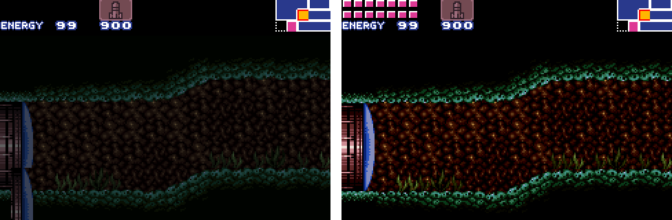
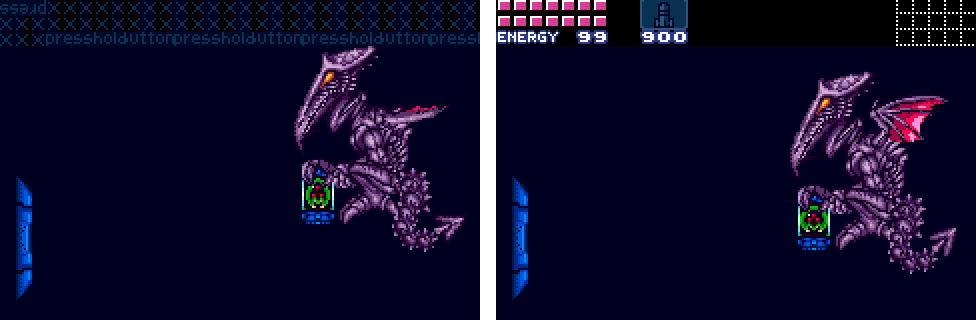
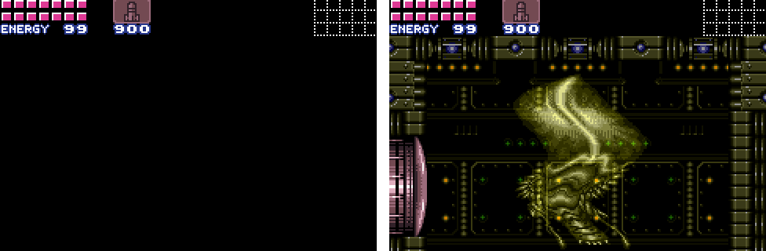

# Super Metroid GBA Progress Report: October 2026

Super Metroid was never meant to fit in your pocket. It was written in 1994
for a console with 128 KB of RAM, a graphics chip built for layered,
scrolling worlds, and a whole second computer just for its music. The Game
Boy Advance has 32 KB of fast RAM, a smaller screen, and a sound system that
amounts to two 8-bit DACs and a timer.

This is the first progress report, and it covers everything: two days in
which the port went from a black screen to every room of the game, the
bosses included, at or near 60 frames per second. That's 55 commits on the
`gba-port` branch. Some of them are big features, some fix bugs that took
an afternoon to find and a line to fix, and a few are the tools that made
the rest checkable. One fixes the same bug twice, a day apart.

There's no emulator anywhere in this. The
[snesrev/sm](https://github.com/snesrev/sm) project decompiled the whole
game into C, function by function, and its PC build checks that C against
the original game every frame. That makes it a faithful copy of the game
that compiles for any CPU, including the GBA's ARM7TDMI. So the plan was to
compile the game's logic for the GBA, leave it alone, and write new code
only where the game meets the hardware: the picture, the sound, the controls
and the memory.

Let's get to it.

## Notable Changes

### 17dad34 - Port to the Game Boy Advance

The toolchain is clang and lld, with no GCC, devkitARM or vendor SDK. That
means no sysroot either, so the port brings its own startup code, linker
script, cartridge header and small C library. The game's logic in
`src/sm_*.c` compiles unchanged; `gba/` replaces the PC build's platform
layer.

Before the game could boot at all, it had to get past alignment. The
decompiled C is faithful to a CPU that has no alignment rules: the 65816
reads a 16-bit value from any address, and the game casts byte pointers to
wider types everywhere. The ARM7TDMI reads a 32-bit value from an odd
address by quietly rotating it, which returns garbage without crashing. The
fix was to make the game's `uint16` and `uint32` types 1-byte aligned on the
GBA. The compiler then emits byte loads wherever the game might misbehave,
and the C stays the same as the PC build's.

The rest of this first commit is the translation layer. The game talks to
the SNES's graphics chip as every SNES game does: it writes registers,
uploads tiles over DMA, and reprograms the chip partway down the screen
with HDMA. The renderer keeps a model of the SNES's video memory and
registers, and once a frame turns it into the GBA's terms:

- SNES Mode 1 has two 16-color layers and one 4-color layer, each tile with
  a priority bit. On the GBA it's four tiled backgrounds, with one SNES layer
  split in two by tile priority, so that sprites can sit between its halves
  as they do on the SNES.
- Mode 7, the rotating, scaling layer of the intro and of Ceres station,
  becomes the GBA's affine background.
- HDMA becomes a stream of GBA registers, copied in before each line by the
  GBA's own HBlank DMA.
- The GBA shows 240x160 pixels, the SNES 256x224. In gameplay the picture
  is a 1:1 crop that follows Samus, with the HUD pinned at the top.

It reached the title screen, the file select and Ceres station. No sound, no
transparency, and a frame rate in the twenties, but it was the real game,
making its own decisions, on a handheld.

### 3b23ee4 - Run at 60 frames per second

The first guess was that the game's own logic was too slow for a 16.8 MHz
CPU. A profiler proved that wrong.

That profiler is `smrun`, a small headless runner built on mGBA's library.
It runs the cartridge with a script of button presses and charges every
cycle to a function, or to an instruction. It showed that the game's logic
was never the problem. The time went to the layer between the game and the
hardware: DMA copied a byte at a time through emulated ports, every HDMA
write was recorded even when it changed nothing, and each line's GBA
registers were rebuilt from scratch.

So the fixes went into that layer. DMA to video memory copies in bulk. The
display records the SNES's registers only when their values change. The
translation layer runs from IWRAM, the GBA's 32 KB of fast internal RAM, as
32-bit ARM code instead of the 16-bit Thumb used elsewhere. Maps convert 16
entries at a time, only where the game changed them.

Ceres went from 2 to 2.5 GBA frames per game frame to about 180,000 of
the 280,000 cycles in one, and the landing site on Zebes to about 240,000. Both
run at 60 fps.

From here on, IWRAM was the scarcest thing in the project. Every feature
since has had to earn its bytes, and the linker refuses to build when IWRAM
would run into the stack.

### 4f6a44d - The whole screen outside gameplay

The title, menus and pause screen have text, and a 240x160 crop of them
cuts words in half. Outside gameplay the port shows the whole SNES screen,
squashed: 6 of every 8 lines, always the same two rows of each tile, and
sprites scaled by 3/4.

This commit also fixed a black pause screen. Its BG3 is a black fill behind
everything, in tiles without the priority bit, but the GBA has no fifth
background to split BG3 by priority, so the renderer had put all of BG3 in
front. The fix: a BG3 map goes in front only if it has priority tiles. Keep
that rule in mind, because it comes back.

### c4efc8f, ed46f8f - Teaching the GBA to sing

Super Metroid's music comes from the SNES's SPC700, a sound CPU with 64 KB
of RAM and an 8-voice sampler chip. The decompilation had translated the
game's sound driver to C, so it runs on the GBA's main CPU like everything
else.

The GBA has no 64 KB to spare. But everything the driver reads from that
RAM was uploaded from the ROM in the first place, so on the GBA it reads the
ROM directly, through a map of where each upload came from. The 175 samples,
compressed in the SNES's BRR format, are decoded to 8-bit PCM when the
cartridge is built. In place of the sampler chip, a mixer in ARM assembly
mixes eight voices, with the SNES's envelopes, noise and echo, at 10512 Hz.

The second commit moved the mixing into a timer interrupt after each VBlank.
Mixing a frame's sound once per game frame had a nasty failure mode: after
one slow frame the next had two frames of sound to mix, so it was slow too,
and so on. Driven by the GBA's own frames, a slow game frame no longer
stalls the music.

Checking it was its own project. `tools/spcref.c` plays the same sound
requests through the PC build's driver and emulated sound chip, and
`tools/compare_audio.py` compares the two recordings' loudness over time and
across octaves.

### 6a22248, 1fe60ca - Color math and windows

The SNES can add or subtract a whole second picture, the "sub screen", to or
from the main one, pixel by pixel. Super Metroid does it constantly: rain on
Crateria, fog, water, the glow of lava, darkness. The GBA can only blend a
layer with the one directly beneath it.

Addition doesn't care about order, though. Draw the sub screen's layers on
top, blend them down, and the sum is the same. The fixed color the SNES adds
or subtracts is folded into the palette. The SNES's two windows, which shape
the X-ray scope's cone and power bombs' blasts, map onto the GBA's two, with
their edges moving every line in the same DMA stream as the scrolling.

Subtraction had to wait.

### eb37393, 1078097 - The hills that wouldn't let Samus climb

With the picture and sound working, Samus landed on Zebes, walked right, and
stopped at the foot of the first hill. She couldn't climb a slope.

Playing and guessing wasn't going to find this one, so the port gained a
flight recorder. A trace build logs the joypad and a hash of the game's
state every frame. A host tool, `hostrun`, replays that joypad on the PC
build, which is itself checked frame by frame against the original game.
The two logs went their separate ways at the exact frame Samus loaded the
room.

The cause was a single `memcpy`. As a room loads, the game copies its slope
data (BTS) out of the level data to just past it, and in big rooms the
source and destination overlap. That's undefined behavior. The PC's C
library happens to copy such buffers safely; the GBA's fast `memcpy`,
copying front to back, overwrote the data before reading it. The fix went
into the game source, `memmove` for the overlapping copies, and `memcpy`
went back to being fast. It's on the list of
[issues to report upstream](UPSTREAM-ISSUES.md).

### 8fc7722 - Ridley's door

Near the end of the Ceres escape, the player has to find the door out of
Ridley's room. On the GBA it was nearly invisible: Ridley, the floor, and the
door's blue cap floating in darkness.

That room draws its walls, blocks and door frame on the SNES's second
background, in priority tiles, behind a first background that's one solid
dark tile across the screen. The renderer had assumed what's true of nearly
every room, that the first background is the one worth splitting by
priority. Now it counts each background's priority tiles as it converts
their maps, and in a frame where the second shows more, it splits that one
instead.

### 229d58e, b8cbbbc - Every room, one by one

Bugs like Ridley's door raised a question: how many other rooms are broken
somewhere nobody has walked yet?

To answer it, the port gained a tour. A test build reads the door lists out
of the ROM, finds all 254 rooms on Zebes by walking from door to door, and
sends Samus through a door into each in turn. She can't die on the way, and
she's pinned where she comes in; otherwise she falls back through the door
she came up through and bounces between two rooms forever. In each room
`smrun` saves a screenshot and the GBA's memory.

Then `tools/snesref.c` takes that memory dump, finds the SNES's video state
in it, and draws the frame with the PC build's SNES graphics emulator: what
a real SNES would have shown from the very same state. A script crops it as
the GBA does and ranks the rooms by how much differs.

The first ranking was humbling. Only 130 of the 254 rooms were within 5% of
the SNES's picture. The tour ran again after every fix:

- **Fog rooms.** A third of the game puts the fog alone on the main screen
  and the room on the sub screen. On the GBA the fog won a priority tie and
  covered the room, so some rooms were pitch black. Now the room is drawn
  as usual with the fog blended on top.
- **Fog between layers.** Brinstar's dark rooms and the Wrecked Ship add
  fog to the background but not the foreground. The fog layer now slides
  between them.
- **Kraid's lair**, the only room with a 64x64 tile map, showed its top
  half. Now it shows the half on screen.
- **One line off.** In Norfair's heat shimmer every line of the background
  was its neighbor's. The SNES shows background row `scroll + 1` on its
  first visible line, and the GBA row `scroll`. With a still background
  that's an invisible one-pixel shift, and the comparison script had been
  quietly compensating for it.
- **The HUD's seam.** Three lines under the HUD showed only the backdrop.
  When `DISPCNT` switches a background on partway down the screen, the GBA
  waits three lines before drawing it. The gameplay layers now stay on from
  the top of the frame, blacked out behind the HUD.
- **Subtraction.** Maridia's and Tourian's shadows subtract, and the GBA
  can't. But subtraction can be split in two: the palette subtracts one
  color from the whole room, and the shadow layer, drawn on top, adds back
  the difference between that color and its own. A few dozen sampled pixels
  pick which of three approximations comes closest, and which color to
  subtract, channel by channel. The samples are staggered: the first grid
  stepped down the screen in multiples of eight lines, so every sample
  landed on the same row of its tile and missed the thin lines of Maridia's
  shadow pattern entirely.

After all that, 252 of the 254 rooms matched the SNES to within 5%, most of
them pixel for pixel. The total difference was a ninth of what it was.

*Before the tour (left) and now. The door was drawn twice over, the colors
were off, and the HUD had lost its energy tanks.*

### 5691898, ce1002f, 2078cd2 - Water and heat at full speed

The tour could also time each room, and the timings showed what screenshots
couldn't. Most of Norfair and Maridia ran at 25-40 fps.

Norfair's heat shimmer and Maridia's water scroll a background differently
on every line. HDMA writes them from tables in ROM, one entry a line, each
pointing at the wave the game computes in RAM. The port replayed that HDMA a
line at a time, with a full copy of the graphics chip's registers for every
line. 160 lines of that took most of a frame.

The first fix gave the scrolling states of its own, apart from the other
registers, which stay few. That saved about 70,000 cycles a frame, and
wasn't enough. The second fix stopped emulating those tables and read them
as the game means them: each table is walked once and cached ("baked") as
the lines it writes and where their values are in RAM, and each frame
those channels fill in the lines' scrolling in one tight pass. Norfair went
from 32 to 52 fps on average and Maridia from 32 to 53.

Then the cache missed in an interesting way. While the camera scrolls, the
game starts the wave table an entry or two further along every frame, so
each frame asked for a "new" table, missed the cache, and fell back to the
slow path. In Maridia's `d913` the camera's scroll down to Samus took 269
VBlanks for 180 frames. Now a table that's a whole number of entries off
from a cached one is slid into place, and only the lines that came on
screen are baked. Those 180 frames take 209 VBlanks. Over the whole tour,
122,880 tables built this way were checked against the old line-by-line
walk, and every one matched.

### 4326a01, 2cb9028 - Fading without dividing

A door fades the screen out and in again, working out each of up to 512
colors' channels a step at a time with the SNES's hardware divider: some
1,500 divisions a frame. The ARM7TDMI has no divide instruction, so each was
a call into compiler-rt's software division, and a door spent 18% of its
time dividing.

First the divider became a multiply: `a / b` is the top word of `a` times a
rounded-up reciprocal of `b`, exact for every 16-bit `a` and every `b` from 2
to 255 (all of them checked). Then the fades stopped dividing at all. For a
given step of a fade, a channel's result depends only on its value and its
target, 0-31 each, and the game's fades are 6, 8, 12 or 15 steps long. So
the build works out all 41,984 results ahead of time, into 41 KB of ROM.

The tour's 254 doors went from a median of 172 GBA frames each to 145. The
SNES takes 105.

### 5742f8f, b74d1c0 - Smaller, and things that didn't work

Compiling each function into its own section let the linker drop the unused
ones: the engine went from 1.26 MB to 1.02 MB. The decompilation also had
2,111 functions used in only one file but declared for all of them, so the
compiler kept a copy of each that nothing called. They're `static` now,
another fix [to offer upstream](UPSTREAM-ISSUES.md).

Some ideas were measured and dropped. `-O2`, `-Os` and `-Oz` were all slower
than `-O3`. Full LTO placed the IWRAM code in ROM and ran at half speed;
thin LTO inlined so much across files that IWRAM overflowed. One commit
(675c3f0) moved code placement from file names to sections to make LTO
possible, and was reverted (18622d1) once LTO turned out slower anyway.

### 30ce5dd, 22c5ef4 - Squashed screens that keep their text

Squashing 224 lines into 160 means dropping two of every eight, and which
two decides whether you can read the menus. The plan had been to drop rows 3
and 7 of each tile, sparing the tops and bottoms of letters. But the SNES
shows background row `scroll + 1` on its first line (that rule again), so
the port was really dropping rows 0 and 4: the tops of letters and the bars
of E and A. "BOTTLED", "NO DATA" and EXIT were cut off.

The first fix analyzed the text on screen to pick which lines to drop, band
by band. Letters came out uneven, and they changed shape as more of a
screen was analyzed. The second fix is simpler and better. It drops the
lines that show rows 0 and 4 of the text layer's tiles, following the
scrolling. As tiles are converted, row 0 is merged into row 1 and row 4 into
row 3, keeping whichever pixel is brighter. Letters keep their strokes over
their outlines and shadows, and nothing changes as you look at it.

Sprites got the same care. Eight-line sprites (mostly text, like "©1994
Nintendo") aren't scaled any more. Sprites flipped left to right had lost a
column, because the GBA flips a scaled sprite about its middle and takes
columns `width..1`. The copies of the tiles in the right half of sprite VRAM
are now stored flipped, in reverse order. The intro's gunship used to have a
gap every 16 pixels.

### b20e159, 60860ae, f8f98fc, 2753549 - The GBA's own buttons

The GBA has no X or Y, so gameplay uses the GBA Metroids' layout: A jumps,
B shoots, L aims diagonally, R readies missiles, and Samus always runs.
Then the details:

- Message boxes come up during gameplay, where the port remaps the
  buttons. The save question's "no" did nothing, and held buttons closed
  item boxes the moment they appeared. While a box is up, the buttons are
  now the SNES's of the same name.
- The X-ray scope shines while the run button is held, and Samus always
  runs, so picking the scope turned it on. While it's picked, R is the run
  button.
- Select used to pick missiles, which R already readies. It now cycles R's
  item through super missiles, the grapple beam and the X-ray scope.
- The item pickup boxes told you the SNES's buttons. They're rewritten for
  the GBA's, in the message font's own letters and icons: "hold R (missile)
  & press the B button."
- The options menu's Controller Setting Mode showed the SNES's buttons and
  let you remap them, though the GBA's controls are fixed. It now draws the
  GBA's buttons, with round A and B, shoulder tabs and a d-pad, and only END
  and RESET do anything.

### be704b4 - The tour finds a crash

The tour pins Samus where she comes in, and in one Maridia room that was
inside a block. The GBA reset. A new `smrun` option, `TRAP0`, shows the
instructions before any jump to address 0, and found a null function
pointer. The spike and grapple blocks' reactions look up a table by the
block's BTS byte, which can be past the table's end; the C read whatever
followed. Which pointer it read depended on the build's layout, so an
unrelated commit set it off. A BTS past the table now does nothing, and it's
on the [upstream list](UPSTREAM-ISSUES.md).

### 04c8dfe, 400b345 - Ceres sounded awful

Compared with the SNES, the GBA had 32 to 46 dB too much between 1.6 and 5
kHz in Ceres's elevator room, where the SNES has next to nothing. Besides the
8-bit DAC, there were two causes:

- A voice's volume times its envelope was kept in 5 bits. Ceres's quiet
  voices were 1s to 4s, so their fades moved in steps of a quarter or more,
  and rounding down lost a third of their loudness. Now it's 8 bits.
- Ceres's ambience plays its samples slowly, at a seventh to a third of
  the mixer's rate, each held for several output samples. That's a
  staircase, and it buzzes at the sample rate with images at 1-3 kHz. The
  SNES interpolates, and now the mixer does too, for voices played slower
  than half its rate.

Then the envelopes. They ran each few-millisecond chunk at the rate their
state had at its start, so a note's attack, done in a step or two, went on
at its quick rate through the decay and sustain. Notes faded too soon, and
the music was 3.5 dB quieter than it should be. Each envelope state now
steps at its own rate.

Faster too. Silent voices still advance without being mixed (5b3d4d2):
28% of the voices mixed had been silent, 42% in Maridia. The driver now
runs four ticks at a time, at 125 Hz, and the envelopes once each 250 Hz.
Sound in Ridley's Ceres fight went from 79,000 cycles a frame to 61,000.

### 50825c8, 91873f3 - Less work for the same picture

The game uploads Samus's and the enemies' tiles every frame, mostly the
same as the frame before, and each upload was converted again. Now a chunk
of VRAM is marked dirty only when its contents actually differ. In
Brinstar's morph ball room with sidehoppers the picture takes 86,000 cycles
a frame, down from 101,000. A merged scan of the lines' states saved another
13,000 a frame in Ridley's Ceres fight.

### e5d5c71 - The HUD over Mode 7, and the BG3 rule, again

Taking the README's new screenshots turned up two more bugs.

*Ridley's fight in Ceres, before (left) and after.*

In Ceres's Mode 7 rooms, the HUD showed "press hold button" text. The GBA's
VRAM was right; the HUD layer was scrolled 264 lines down, onto an old map.
The code stored the scroll registers four bytes at a time into a field of
the display segment that sits at an address that isn't a multiple of four.
The ARM7TDMI doesn't fault on that. It rounds the address down, so every
value landed two bytes early: the window settings got the HUD's horizontal
scroll, and the HUD's vertical scroll got another layer's. The alignment
rule from the very first commit, again, this time in the port's own code.

*Phantoon appears, before (left) and after.*

When Phantoon appeared, the whole gameplay area went black. Remember the
pause screen's rule from earlier: a BG3 map goes in front if it has priority
tiles. In Phantoon's room the HUD's priority tiles share a map with the
room's own BG3, an opaque black fill that the SNES draws behind everything.
The HUD's tiles put it all in front. Now BG3 goes in front only where the
map rows a part of the screen shows have priority tiles. Re-running the
tour after both fixes, no room's ranking moved.

## Other changes

- **23234ee** The build makes `sm-engine.gba` with none of the game's data,
  and `tools/make_cartridge.py` appends the data from your own ROM. CI
  releases the engine only.
- **ccf907e** The intro's playback of the Mother Brain fight, like the
  attract demos, plays recorded SNES buttons. The GBA's item picking ignored
  them, so Samus never switched to missiles and the playback never ended.
- **254ad66** While a door loads the next room with the SNES's screen off,
  the GBA's is off too, instead of showing the last frame over graphics
  being replaced.
- **d6b2bc5** VRAM changes made while no tiled layer is on screen wait for
  the next frame that shows one. Converting everything instead had the
  Mode 7 flight to Zebes running at a third of full speed.
- **22c5ef4** The gameplay area follows Samus's feet and only moves once
  she's 12 lines from the middle, so crouching doesn't move the screen. The
  Ceres escape's timer stays put as it does.
- **f6c58ee, b68773f** Running the PC build and `hostrun` under ASan and
  UBSan found the menu tilemap declared a quarter of its size, and `hostrun`
  drawing through an uninitialized pointer.
- **bdcfa87, e9e18cf** The tour can start in Ceres, and it now times each
  room for 60 frames once the camera has stood still for 60. Coming into a
  room, the camera scrolls to Samus for seconds and with pauses, and timing
  that measured the scroll, not the room.

## What's left

Timed over the whole tour, settled in each room: 24 rooms take more than 60
VBlanks for 60 frames, 7 take more than 61, and none runs below 50 fps. The
slowest, Maridia's `d4c2`, runs at 55.4. That's with Samus standing still,
though, and some things are still slow:

- Ridley's fight in Ceres runs at about 50 fps on average, between 37 and
  58 from second to second.
- A door still takes 145 GBA frames where the SNES takes 105.
- The X-ray scope and big power bomb explosions slow the game down.

And some things aren't the SNES's yet:

- The SNES does color math only on sprites with palettes 4-7. The GBA
  blends all of them, so bosses come out pale under the fog layer.
- Power bombs' explosions brighten the screen rather than turning it
  yellow.
- In Ridley's Ceres lair the background gets lighter toward the bottom on
  the SNES, and is one flat color on the GBA.
- The GBA's 8-bit sound has a hiss the SNES never had.

But all of Zebes is there, and almost all of it at full speed, in your
hands.

## This Report's Contributors

Every commit is by Nick Desaulniers, co-authored with Claude Opus 5.5. The
port stands on the [snesrev/sm](https://github.com/snesrev/sm)
decompilation and its authors, and on [mGBA](https://mgba.io), whose library
runs every test here.
